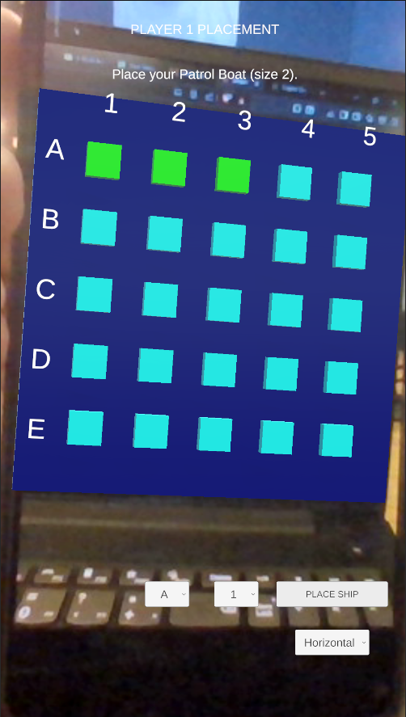
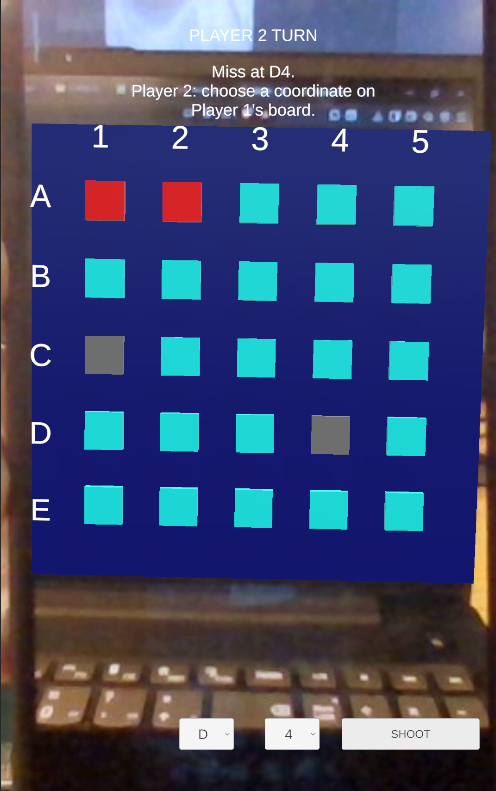

# AR Sea Battle




## Project Description

AR Sea Battle is a two-player Augmented Reality Battleship game developed in Unity using the Vuforia Engine.

Each player has their own printed image target. When the marker is scanned, a virtual 5×5 game board appears on top of it. Players place their ships, pass the phone, exchange markers, and then take turns attacking each other's fleet.

The application was developed as the final project for the **Augmented Reality** course.

---

## Features

- Augmented Reality gameplay using Vuforia Image Targets
- Two independent AR game boards
- 5×5 Battleship game
- Two-player pass-the-phone gameplay
- Ship placement
- Hit and miss detection
- Ship sinking
- Win detection
- Sound effects
- Particle effects
- Coordinate labels
- Android support

---

## Requirements

- Android phone with a camera
- Camera permission enabled
- Two printed image markers
- ARSeaBattle.apk

---

## Installation

1. Copy **ARSeaBattle.apk** to your Android phone.
2. Install the application.
3. Allow camera permission if requested.
4. Print or display both image markers.
5. Launch the application.

---


## Image Markers

The application requires two image markers.

They are available in the **Markers** folder.

Print them or display them on another device before starting the application.

---

## How to Play

### Ship Placement

1. Scan **Player 1 Marker**.
2. Place both ships using the UI.
3. Pass the phone to Player 2.
4. Scan **Player 2 Marker**.
5. Place both ships.
6. Exchange the physical markers.
7. Press Continue.

### Battle Phase

Players take turns.

For each turn:

1. Select a coordinate.
2. Press **Shoot**.
3. The board displays:
   - Hit
   - Miss
   - Ship sunk
4. Continue until one player sinks all opponent ships.

---

## Controls

### Placement Phase

- Letter dropdown
- Number dropdown
- Direction dropdown
- Place Ship

### Battle Phase

- Letter dropdown
- Number dropdown
- Shoot

### Other

- Continue
- Restart Game

---

## Technologies Used

- Unity 6
- Vuforia Engine 11.4.4
- Universal Render Pipeline (URP)
- C#

---

## Project Structure

```
Assets/
 ├── Scenes/
 ├── Scripts/
 │    ├── Game/
 │    ├── UI/
 │    └── ...
 ├── Prefabs/
 ├── Materials/
 ├── Audio/
 └── StreamingAssets/
```

---

## Authors

Arsenije Đorđević

University of Primorska  
Faculty of Mathematics, Natural Sciences and Information Technologies (UP FAMNIT)

Course: Augmented Reality